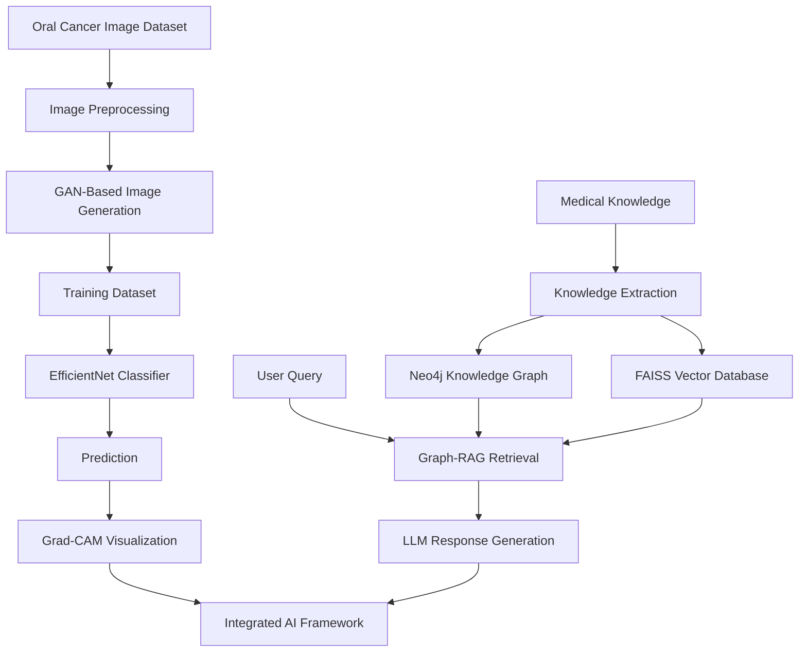

# 🦷 GAN-Based Deep Learning Framework with Graph-RAG for Oral Cancer Detection

<p align="center">
  <strong>An Explainable AI Framework for Oral Cancer Detection, Synthetic Image Generation, and Knowledge-Graph-Based Medical Retrieval</strong>
</p>

<p align="center">
  
  
  
  
  
  
  
</p>

---

## 📌 Overview

Oral cancer is a serious healthcare challenge where early identification and accurate interpretation of clinical information are important.

This project presents an integrated AI framework that combines **Generative Adversarial Networks (GANs), deep learning, Explainable AI (XAI), and Graph Retrieval-Augmented Generation (Graph-RAG)** to support oral cancer image analysis and contextual medical knowledge retrieval.

The framework aims to go beyond conventional image classification by integrating visual predictions, explainability, and structured medical knowledge into a unified pipeline.

### 🎯 Key Objectives

- Develop a deep learning-based framework for oral cancer image classification.
- Explore GAN-based synthetic image generation to address dataset limitations.
- Leverage EfficientNet for automated visual feature extraction and classification.
- Apply Grad-CAM to visualize regions influencing model predictions.
- Build a knowledge graph using Neo4j to represent connected medical information.
- Integrate FAISS-based vector retrieval with LLM-powered contextual responses.
- Combine visual intelligence and knowledge retrieval into an integrated framework.

---

## 🏗️ System Architecture

The framework consists of four major components:

1. **Generative Module:** GAN-based synthetic image generation and augmentation.
2. **Classification Module:** EfficientNet-based oral cancer image analysis.
3. **Explainability Module:** Grad-CAM-based visualization of important image regions.
4. **Knowledge Retrieval Module:** Graph-RAG using Neo4j, FAISS, and an LLM.

### Overall Workflow



---

## 🧠 Core Technologies

| Component | Technology | Purpose |
|---|---|---|
| Programming | Python | Core development |
| Deep Learning | TensorFlow / Keras | Model development |
| CNN Architecture | EfficientNetB0 | Image feature extraction and classification |
| Generative AI | GAN / CycleGAN | Synthetic image generation |
| Explainable AI | Grad-CAM | Visual interpretation |
| Graph Database | Neo4j | Medical knowledge representation |
| Vector Search | FAISS | Semantic retrieval |
| Embeddings | Sentence Transformers | Text embeddings |
| LLM Integration | Groq | Contextual response generation |
| Visualization | Matplotlib | Result visualization |

---

## 📂 Dataset

The project uses an oral cancer histopathological image dataset containing two classes:

- **OSCC:** Oral Squamous Cell Carcinoma
- **Normal:** Normal oral tissue

### Dataset Distribution

| Split | OSCC | Normal |
|---|---:|---:|
| Training | 2,511 | 2,435 |
| Validation | 92 | 28 |
| Testing | 95 | 31 |
| **Total** | **2,698** | **2,494** |

**Dataset source:** [Kaggle – Oral Cancer Dataset](https://www.kaggle.com/datasets/ashenafifasilkebede/dataset)

The dataset is used for image preprocessing, model development, and evaluation.

---

## ⚙️ Methodology

### 1. GAN-Based Synthetic Image Generation

Generative Adversarial Networks are explored to generate synthetic histopathological images.

The objective is to investigate whether generated samples can improve dataset diversity and support deep learning model training.

GAN approaches explored include:

- Wasserstein GAN (WGAN)
- HistoGAN
- CycleGAN

**CycleGAN Experimental Results**

| Metric | Value |
|---|---:|
| MAE | 0.0918 |
| Identity Loss | 0.0600 |
| Training Epochs | 100 |

These values represent experimental image-generation results, not classification accuracy.

### 2. Deep Learning-Based Classification

EfficientNet is used as the primary image classification architecture.

The classification module learns visual representations from oral tissue images and predicts the corresponding class.

**Classification Categories:**
- Normal
- Oral Squamous Cell Carcinoma (OSCC)

### 3. Explainable AI Using Grad-CAM

Grad-CAM (Gradient-weighted Class Activation Mapping) is integrated to improve the interpretability of model predictions.

It generates heatmaps that highlight image regions contributing to the model's prediction.

This helps visualize what the model focuses on instead of presenting only a classification result.

### 4. Graph-RAG Knowledge Retrieval

The Graph-RAG module integrates structured knowledge representation and semantic retrieval.

**Neo4j – Knowledge Graph**

- Represents medical concepts and their relationships.
- Stores connected information in a graph structure.
- Supports relationship-based retrieval.

**FAISS – Vector Retrieval**

- Stores vector embeddings.
- Performs similarity-based semantic search.
- Retrieves relevant contextual information.

**LLM – Response Generation**

- Uses retrieved context to generate natural-language responses.
- Integrates graph and vector retrieval.
- Supports contextual question answering.

The current implementation uses Groq for LLM inference.

---

## 🔬 Experimental Results

| Experiment | Result |
|---|---|
| GAN exploration | WGAN, HistoGAN and CycleGAN |
| CycleGAN training | 100 epochs |
| CycleGAN MAE | 0.0918 |
| CycleGAN Identity Loss | 0.0600 |
| Image classification | EfficientNet-based |
| Explainability | Grad-CAM |
| Knowledge graph | Neo4j |
| Vector retrieval | FAISS |
| LLM integration | Groq |

*Note: Classification accuracy, precision, recall, F1-score, and confusion matrix should be added after final evaluation. GAN reconstruction metrics should not be interpreted as classification performance.*

---

## 📁 Repository Structure

```text
GAN-based-Oral-Cancer-detection-with-GraphRag-GradCam/
│
├── models/
│   └──                 # Trained model files
│
├── notebooks/
│   └──                 # Model development and experiments
│
├── results/
│   └──                 # Experimental outputs and visualizations
│
└── README.md
```

---

## 🚀 Getting Started

### Prerequisites

- Python 3.10+
- Jupyter Notebook
- TensorFlow / Keras
- Neo4j
- FAISS
- Groq API access for LLM inference

### 1. Clone the Repository

```bash
git clone https://github.com/SayyadRizwan/GAN-based-Oral-Cancer-detection-with-GraphRag-GradCam.git

cd GAN-based-Oral-Cancer-detection-with-GraphRag-GradCam
```

### 2. Create a Virtual Environment

```bash
python -m venv venv
```

Activate it:

**Windows**
```bash
venv\Scripts\activate
```

**Linux / macOS**
```bash
source venv/bin/activate
```

### 3. Install Dependencies

Install the dependencies required by the respective notebooks and backend modules.

```bash
pip install tensorflow numpy pandas matplotlib scikit-learn opencv-python pillow
pip install faiss-cpu sentence-transformers neo4j
pip install groq
```

### 4. Configure Environment Variables

Create a `.env` file for your credentials.

```env
GROQ_API_KEY=your_groq_api_key
NEO4J_URI=your_neo4j_uri
NEO4J_USERNAME=your_neo4j_username
NEO4J_PASSWORD=your_neo4j_password
```

Never commit API keys, database passwords, or other sensitive credentials.

### 5. Run the Experiments

Open the notebooks directory and execute the relevant notebooks in the intended order.

```bash
jupyter notebook
```

*Note: The exact notebook execution order and backend startup command should be documented alongside the corresponding implementation files.*

---

## 🔮 Future Enhancements

- Evaluate additional CNN architectures and compare classification performance.
- Improve GAN-generated image quality and diversity.
- Conduct systematic ablation studies to measure the contribution of GAN augmentation.
- Extend the knowledge graph with additional medical relationships.
- Improve hybrid graph and vector retrieval.
- Introduce RAG evaluation metrics and retrieval-quality benchmarking.
- Develop a user-friendly interface for image analysis and contextual querying.
- Explore deployment with FastAPI and containerization.

---

## ⚠️ Important Disclaimer

This project is developed for academic research and educational purposes.

It is **not a clinically validated diagnostic system** and must not be used as a replacement for professional medical examination, histopathological assessment, or expert clinical judgment.

---

## 👨‍💻 Author

**Rizwan Ahemad Sayyad**

Final-Year B.Tech | Computer Science & Engineering (AI & ML)

**Areas of Interest:** Deep Learning · Generative AI · RAG · Computer Vision · NLP

- GitHub: [@SayyadRizwan](https://github.com/SayyadRizwan)
- LinkedIn: [Rizwan Sayyad](https://www.linkedin.com/in/rizwansayyad0701/)

---

<p align="center">
  <strong>Bridging Deep Learning, Explainable AI, and Knowledge Graphs for Intelligent Medical Research.</strong>
</p>
