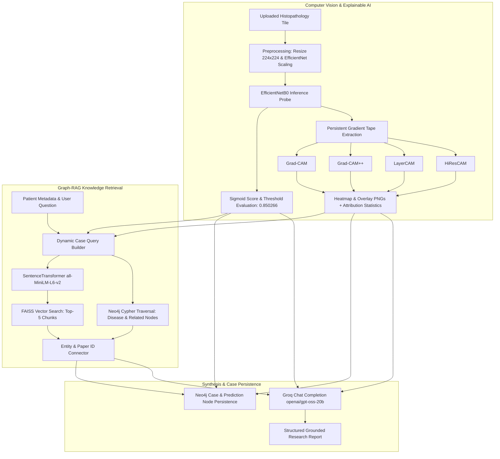

# 03. AI Pipeline & Explainability Audit

**Project:** GAN-based Oral Cancer Detection with GraphRAG and Grad-CAM  
**Audit Date:** November 2026  
**Auditor:** Antigravity AI  

---

## 1. End-to-End Pipeline Architecture

The AI pipeline is designed as an integrated multimodal decision-support framework combining computer vision classification, Explainable AI (XAI), knowledge-graph entity linking, vector retrieval-augmented generation (RAG), and Large Language Model (LLM) research synthesis.



---

## 2. Stage-by-Stage Implementation Details

### Stage 1: Image Preprocessing Contract
- **Input:** Raw binary image bytes (JPEG, PNG, etc.).
- **Tensor Operations:**
  1. `tf.io.decode_image(..., channels=3, expand_animations=False)`
  2. `tf.image.resize(..., (224, 224), antialias=True)`
  3. `tf.cast(..., tf.float32)` with range clipped strictly to `[0.0, 255.0]`
  4. Assertion checks: `tf.debugging.assert_all_finite`, bounds between `0` and `255`
  5. `tf.keras.applications.efficientnet.preprocess_input(resized)`
- **Output:** Normalized model input tensor `(1, 224, 224, 3)` and uint8 RGB array `(224, 224, 3)` for visual overlays.

### Stage 2: EfficientNetB0 Inference
- **Model:** Loaded from `models/best_efficientnetb0.keras` without re-compilation (`compile=False`).
- **Score Calculation:**
  ```python
  probability = float(model(image_tensor, training=False).numpy().reshape(-1)[0])
  label = "OSCC" if probability >= 0.850266 else "Normal"
  confidence = probability if label == "OSCC" else 1.0 - probability
  ```
- **Operating Note:** The decision threshold (`0.850266`) is intentionally conservative to maintain a 0.0% False Positive Rate on the audited test split.

### Stage 3: Explainable AI (XAI) Attribution Engine
The pipeline implements **four distinct gradient attribution methods** executed in a single persistent gradient pass to prevent redundant forward/backward computations:
1. **Grad-CAM:** Standard global-average-pooled gradient weighting.
   $$\alpha_k = \frac{1}{Z} \sum_{i} \sum_{j} \frac{\partial Y}{\partial A_{i,j}^k}, \quad L_{\text{Grad-CAM}} = \text{ReLU}\left(\sum_k \alpha_k A^k\right)$$
2. **Grad-CAM++:** Higher-order derivative weighting using 2nd and 3rd order gradients for improved localization of multiple object instances.
3. **LayerCAM:** Preserves pixel-level positive gradient attributions without global average pooling.
   $$L_{\text{LayerCAM}} = \text{ReLU}\left(\sum_k \text{ReLU}\left(\frac{\partial Y}{\partial A_{i,j}^k}\right) \odot A^k\right)$$
4. **HiResCAM:** Element-wise product of feature activations and gradients without spatial reduction.
   $$L_{\text{HiResCAM}} = \text{ReLU}\left(\sum_k A_{i,j}^k \cdot \frac{\partial Y}{\partial A_{i,j}^k}\right)$$

#### Post-Processing & Metrics:
- **Normalization:** Per-image min-max scaling to `[0.0, 1.0]`. Constant zero maps are preserved as zero.
- **Overlay Generation:** Weighted alpha blend: $0.58 \times \text{RGB} + 0.42 \times \text{Red Heatmap}$.
- **Attribution Metrics:** Mean intensity, standard deviation, 90th percentile (`q90`), and fraction of image area $\ge 0.5$.
- **Cross-Method Agreement:** Computes pairwise Pearson correlation and Cosine similarity across all 6 method pairs.

### Stage 4: Query Construction & Vector Retrieval (FAISS)
- **Dynamic Query Assembly:** Combines model prediction, sigmoid score, threshold, attribution statistical summaries (mean, q90, cross-method Pearson agreement), patient metadata (age, sex, tobacco, alcohol, site, magnification), and optional user research questions.
- **Vector Search:**
  - Queries `sentence-transformers/all-MiniLM-L6-v2` to obtain a 384-dim normalized embedding.
  - Queries `oscc_literature.faiss` for `top_k=5` chunks.
  - Returns chunk metadata (`chunk_id`, `paper_id`, `title`, `authors`, `year`, `source_url`, `text`, `similarity`).

### Stage 5: Neo4j Knowledge Graph Traversal & Linking
- **Graph Traversal Cypher Query:**
  ```cypher
  MATCH (d:Disease {name:"Oral Squamous Cell Carcinoma"})
  OPTIONAL MATCH (d)-[r]-(x)
  WITH d,r,x,toLower(coalesce(x.name,"")+" "+coalesce(x.title,"")+" "+coalesce(type(r),"")) AS search_text
  WITH d,r,x,reduce(score=0,term IN $terms | score+CASE WHEN term<>"" AND search_text CONTAINS term THEN 1 ELSE 0 END) AS query_overlap
  RETURN d.name AS disease,type(r) AS relationship,labels(x) AS node_labels,
         x.name AS node_name,x.title AS node_title,x.paper_id AS paper_id,
         x.year AS year,query_overlap
  ORDER BY query_overlap DESC,relationship,node_name,node_title LIMIT 50
  ```
- **Paper ID Linking:** Automatically associates retrieved FAISS literature chunks with Neo4j graph nodes matching the same `paper_id`.

### Stage 6: Case Graph Persistence
- Creates or updates `(c:Case {case_id: $case_id})` and `(p:Prediction {case_id: $case_id})`.
- Links `(c)-[:HAS_MODEL_PREDICTION]->(p)`.
- If the predicted class is OSCC, links `(p)-[:PREDICTS_CLASS]->(d:Disease {name: "Oral Squamous Cell Carcinoma"})`.

### Stage 7: Grounded LLM Report Synthesis (Groq)
- **Model:** `groq_client.chat.completions.create` targeting `openai/gpt-oss-20b` (or active Groq models such as `llama-3.3-70b-versatile`).
- **Prompt Sanitization & Bounding:** Values are bounded (`max_string=5000`, `max_items=40`, prompt limit `60,000` chars) to protect against context overflow.
- **Strict Guardrails:**
  - Classifier score is explicitly labeled as a continuous model score, not a clinical probability or diagnosis.
  - Heatmaps indicate model attribution only; they do not prove pathology presence.
  - LLM is strictly instructed never to recommend medical treatment or invent citations.
  - Report structure must contain 7 sections: Case Summary; Model Prediction; XAI Attribution; Knowledge-Graph Context; Retrieved Literature; Integrated Research Interpretation; Limitations.

---

## 3. In-Depth Audit of CycleGAN Claims

A critical finding of this audit concerns the title and README claims regarding Generative Adversarial Networks (GANs):

1. **Repository Title:** `GAN-based-Oral-Cancer-detection-with-GraphRag-GradCam`
2. **README Claims:** Section 1 describes WGAN, HistoGAN, and CycleGAN with specific reported metrics (CycleGAN MAE: 0.0918, Identity Loss: 0.0600, 100 epochs).
3. **Audit Investigation Results:**
   - **No Python code, scripts, or functions exist for GANs anywhere in the repository.**
   - **No GAN model weights** (e.g., `generator.h5`, `cyclegan.keras`, `discriminator.pt`) exist in `models/` or any other directory.
   - **No synthetic images** exist in the repository.
   - The training notebook (`oral_cancer_detection_EfficientNet_V2.ipynb`) downloads the Kaggle dataset directly and trains EfficientNetB0 on real images with standard Keras data augmentations.
4. **Conclusion:** GAN / CycleGAN experimentation was either conducted in an uncommitted external notebook or remained a theoretical exploration. **It is not present in the current codebase.**

---

## 4. Execution Feasibility & Resource Matrix

| Pipeline Component | Executable Offline / Locally? | External Dependencies Required | Fallback Strategy If Offline |
|---|---|---|---|
| Image Preprocessing | **Yes** | Local TensorFlow / NumPy / Pillow | None needed |
| EfficientNetB0 Inference | **Yes** | Local weights (`models/best_efficientnetb0.keras`) | None needed |
| 4-Method XAI (Grad-CAM, etc.) | **Yes** | Local weights + GradientTape | None needed |
| FAISS Literature Retrieval | **Yes** (after initial model download) | HuggingFace Hub for MiniLM model (`~90 MB`) | Model can be cached locally |
| Neo4j Context Retrieval | **No** | Active Neo4j database (AuraDB or local Docker) | Graceful degradation: returns empty graph context if unreachable |
| Case Graph Write | **No** | Active Neo4j database | Skipped if Neo4j is offline (`graph_saved=False`) |
| Groq Report Synthesis | **No** | Active Groq API Key & Internet access | Backend fallback error message (`make_report_error_response`) |
